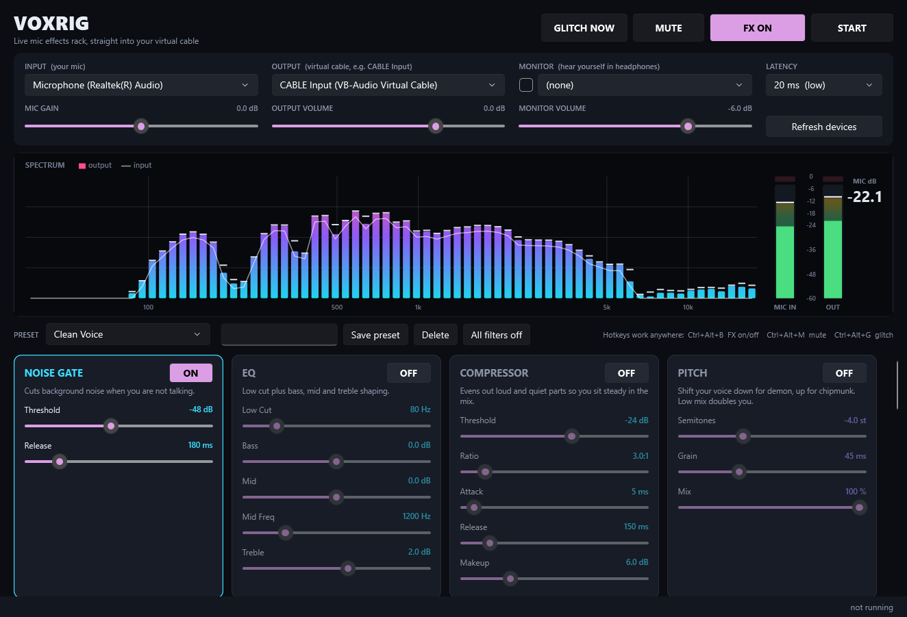

<p align="center"></p>

# VoxRig

Live mic effects rack for Windows. Your mic goes in, effects get applied in real time, and the result goes out to a virtual cable (VB-Cable) so Discord, OBS, games or anything else can use it as a mic.

Native WPF + WASAPI (shared mode, event driven), .NET 10.



## Download

Grab `VoxRig.exe` from the [latest release](https://github.com/XxVoidicxX/VoxRig/releases/latest) and run it. No installer.

Needs Windows 10 or 11 and the [.NET 10 Desktop Runtime](https://dotnet.microsoft.com/download/dotnet/10.0) (Windows will offer to install it on first launch if it is missing). For the virtual mic you also need [VB-Cable](https://vb-audio.com/Cable/) (free).

## Setup

1. Install VB-Cable.
2. In VoxRig: **INPUT** = your real mic, **OUTPUT** = `CABLE Input (VB-Audio Virtual Cable)`. Press **START**.
3. In Discord / OBS / the game: set the microphone to `CABLE Output (VB-Audio Virtual Cable)`.
4. Optional: tick **MONITOR** and pick your headphones to hear yourself.

Don't pick `CABLE Output` as VoxRig's input while also sending to `CABLE Input`. That loops back on itself.

## Controls

| Control | What it does |
| --- | --- |
| FX ON / FX OFF | Turns every filter on or off at once, with a 20 ms crossfade so it never clicks |
| Card ON/OFF | Toggles one effect (also crossfaded) |
| MUTE | Silences the output |
| GLITCH NOW | Fires one random fake mic glitch, even if Mic Glitches is switched off |
| All filters off | Switches every card off |
| Double-click a slider | Resets it to default |
| Latency | 10 / 20 / 40 / 80 ms buffers. Go up if the status bar shows dropouts |

Global hotkeys (work while gaming): **Ctrl+Alt+B** FX on/off, **Ctrl+Alt+M** mute, **Ctrl+Alt+G** glitch.

## Effects (signal order)

- **Clean:** Noise Gate, EQ, Compressor
- **Voice:** Pitch (demon to chipmunk), Robot (ring mod + metal comb)
- **Dirt:** Drive, Bitcrush, Radio (walkie talkie / phone)
- **Space:** Modulation (chorus, flanger, warble), Echo, Reverb (pre-delay up to 500 ms for lagging reverb)
- **Chaos:** Bad Mic (hiss, hum, crackle, flutter, clip), Mic Glitches (dropout, stutter, freeze, crackle burst, digital garbage, muffle), Lag (delay, jitter, lag spikes that stall then speed up to catch up)

A safety limiter after the chain keeps the output from clipping.

## Visualizer

Spectrum bars show the output, the white line shows the raw mic, so you can see what the effects change. Meters on the right show mic input and output level (RMS fill, peak shadow, peak hold line, red clip light), plus a big live mic loudness readout in dB.

## Presets

Built in: Clean Voice, Lag Reverb, Bad Connection, Broken Mic, Cave, Walkie Talkie, Robot, Demon, Chipmunk, Haunted, Total Chaos. Type a name and hit **Save preset** to store your own in `%APPDATA%\VoxRig\presets`. Devices, levels and the current rack are saved on exit and restored on launch.

## Build

```
cd src
dotnet publish -c Release -r win-x64 --self-contained false -p:PublishSingleFile=true -o ../dist
```

Testing without opening the UI:

- `VoxRig.exe --selftest report.txt` runs every preset and extreme settings through the DSP at 44.1/48/96 kHz and checks for NaN, runaway feedback and speed.
- Add `live` at the end to also stream the default mic into CABLE Input for 4 seconds.

## License

MIT
